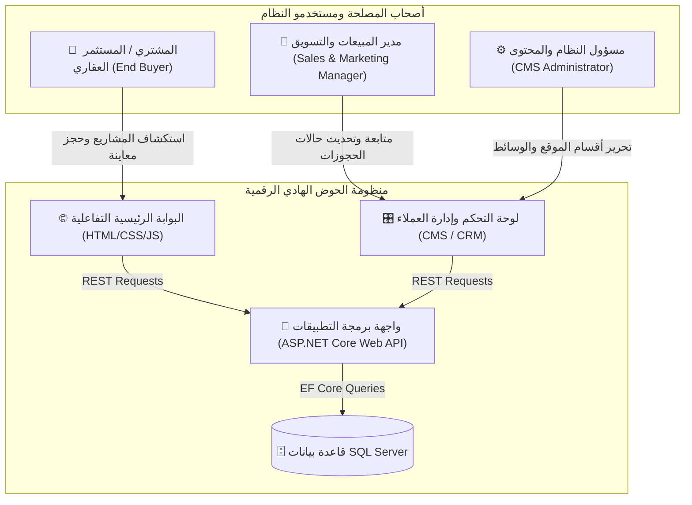
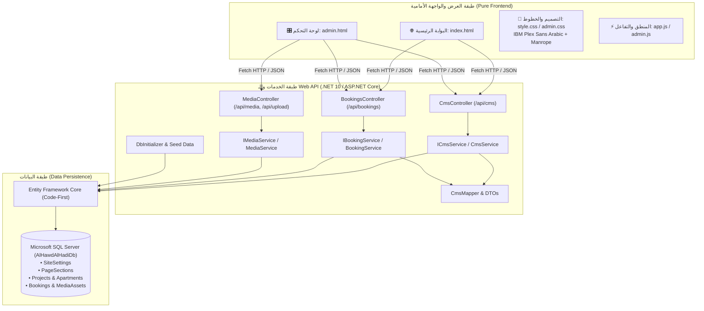
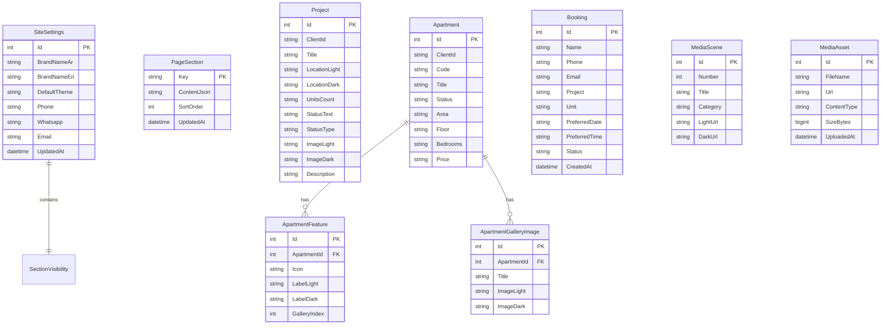

# وثيقة المواصفات المتكاملة للمشروع (SRS & Business Architecture Document)
## شركة الحوض الهادي للإسكان | Al Hawd Al Hadi Housing

---

## 1. ملخص المشروع ونموذج العمل (Business Overview & Value Proposition)

### 1.1 نبذة عن المشروع
منظومة رقمية عقارية متكاملة تم تطويرها لشركة **الحوض الهادي للإسكان**، إحدى الشركات الرائدة في تطوير المجتمعات السكنية الفاخرة في العاصمة الأردنية عمان (عبدون، دير غبار، دابوق، الشميساني).

### 1.2 المشكلة وسياق السوق (Problem Statement)
- التسويق العقاري التقليدي يعتمد على صور ثابتة وغير تفاعلية لا تعكس تجربة الحياة الحقيقية داخل المجمعات السكنية.
- صعوبة استيعاب العميل لتوزيع الشقق ومخططاتها المعمارية (Floorplans) وعلاقتها بالواجهة والشارع.
- بطء دورة معالجة طلبات الحجز والاستفسارات، وعدم وجود نظام مركزي يربط التعديلات الآنية على الموقع بقاعدة بيانات موثوقة.

### 1.3 الحل والقيمة المضافة (Value Proposition)
1. **تجربة بصرية مزدوجة فائقة الفخامة (Day & Night Mode Pairing):** 
   ربط 10 مشاهد معمارية وتصاميم داخلية ملتقطة بدقة للوضعين النهاري والليلي مع تبديل لحظي وسلس يعكس إضاءة المبنى وجمالياته ليلاً ونهاراً.
2. **مستكشف الوحدات التفاعلي (Interactive Unit Explorer):** 
   محاكاة تفاعلية تتيح للمشتري اختيار الطابق، تصفح الشقق (A, B, C)، معرفة حالة التوفر (متاحة، محجوزة، مباعة)، استعراض المخططات، والتنقل في المعرض الداخلي للغرف.
3. **لوحة تحكم للمحتوى والحجوزات (Headless CMS & CRM Dashboard):**
   لوحة قيادة تنفيذية تمكّن فريق التسويق والمبيعات من تعديل كل نصوص وصور وأسعار ومرافق الموقع، إدارة مواعيد المعاينة، ومتابعة العملاء عبر قنوات اتصال مباشرة (هاتف وواتساب).

---

## 2. أصحاب المصلحة والمستخدمون المستهدفون (Target Personas)

1. **المشتري والباحث عن سكن فاخر (Home Buyer):**
   - يبحث عن شقة بمواصفات وتشطيبات فندقية في عمان.
   - يحتاج إلى شفافية كاملة في المساحات، التقسيمات الداخلية، الإطلالة، والأسعار دون الحاجة للاتصال الأولي.
2. **فريق المبيعات وإدارة الحجوزات (Sales Representative):**
   - يحتاج لمعرفة بيانات العميل فور تقديم طلبه وتحديد موعد للمعاينة والتواصل الفوري عبر الواتساب أو الاتصال.
3. **مدير المحتوى (Content Administrator):**
   - يحتاج للتحكم بحالات الشقق (متاحة/محجوزة/مباعة)، إضافة مشاريع جديدة، رفع صور معمارية حديثة، وتعديل بيانات الاتصال بنقرة زر وبدون تدخل برمجي.

---

## 3. قصص المستخدمين ومعايير القبول (User Stories & Acceptance Criteria)

### Epic 1: الاستكشاف البصري والتفاعل مع الواجهة (Public Portal)

#### US-01: التبديل بين الوضع النهاري والليلي
- **كـ** مشتري محتمل يتصفح الموقع،
- **أريد** التبديل بين الوضع النهاري والوضع الليلي بضغطة واحدة،
- **حتى** أرى كيف يبدو المجمع السكني والتصميم الداخلي للشقق تحت الإضاءة الطبيعية نهاراً والإضاءة المعمارية ليلاً.
- **معايير القبول:**
  - الانتقال يتم بسلاسة (CSS Smooth Transitions) دون إعادة تحميل الصفحة.
  - جميع الصور (10 أزواج معمارية) تتبدل تلقائياً لنسختها الليلية المتطابقة.
  - حفظ الخيار المفضل للمستخدم محلياً (`localStorage`).

#### US-02: مستكشف الطوابق والشقق التفاعلي
- **كـ** مشتري مهتم،
- **أريد** تحديد الطابق (1 إلى 6) واختيار شقة معينة (A, B, C) على واجهة المبنى التفاعلية أو المخطط،
- **حتى** أتعرف على مساحتها، اتجاهها، عدد غرفها، وسعرها التقريبي ومخططها الهندسي.
- **معايير القبول:**
  - عرض شارات الحالة (متاحة بلون أخضر، محجوزة بلون رمادي، مباعة بلون أحمر).
  - عند اختيار أي شقة، يتحدث المعرض الداخلي فوراً ليعرض صور الصالة، المطبخ، غرف النوم، والحمامات الخاصة بتلك الوحدة.
  - دعم زر سريع لتحميل مخطط الشقة المعماري أو الانتقال لحجز موعد مشاهدة مع تعبئة رقم الوحدة تلقائياً.

#### US-03: حجز موعد مشاهدة ميدانية
- **كـ** عميل يرغب بزيارة المشروع،
- **أريد** تعبئة نموذج حجز موعد بسيط يحدد اسمي، هاتفي، المشروع والوحدة المهتم بها، والوقت المفضل،
- **حتى** يقوم فريق المبيعات بتجهيز الشقة واستقبالي في الموقع.
- **معايير القبول:**
  - التحقق من صحة رقم الهاتف والاسم إلزامياً (Client-side & Server-side Validation).
  - إرسال الطلب إلى الـ API عبر `POST /api/bookings` وظهور رسالة تأكيد فورية للمستخدم.
  - حفظ الطلب مباشرة في قاعدة بيانات SQL Server بحالة `new`.

---

### Epic 2: لوحة الإدارة والتحكم (Executive CMS & CRM)

#### US-04: التحكم بأقسام الموقع ونصوصها (Headless CMS)
- **كـ** مدير محتوى،
- **أريد** واجهة مرئية منظمة بتبويبات فرعية تتيح لي تعديل أسماء المشاريع، الأسعار، النصوص الترويجية، والمرافق،
- **حتى** يبقى الموقع مواكباً لأحدث التطورات دون طلب تعديلات من المبرمجين.
- **معايير القبول:**
  - وجود مؤشر حالة الحفظ التفاعلي (Sync Status Pill) الذي ينبه في حال وجود تعديلات غير محفوظة.
  - إمكانية الحفظ السريع عبر اختصار لوحة المفاتيح `Ctrl + S`.
  - إمكانية تفعيل أو تعطيل ظهور أي قسم من الأقسام التسعة الرئيسية عبر مفاتيح تبديل سريعة (`ios-switch`).

#### US-05: المعاينة الحية المنقسمة (Split-Screen Live Preview)
- **كـ** محرر للمحتوى،
- **أريد** فتح نافذة معاينة حية للموقع داخل لوحة التحكم بجانب حقول الإدخال،
- **حتى** أشاهد تأثير التعديلات فور حفظها على النسخة النهارية والليلية دون مغادرة الداشبورد.
- **معايير القبول:**
  - إمكانية فتح وإغلاق لوحة المعاينة بزر مستقل.
  - توفير أزرار تحكم علوية لمعاينة الوضع النهاري، الوضع الليلي، وتحديث الـ `iframe`.

#### US-06: إدارة طلبات الحجز ومتابعة العملاء (Bookings CRM)
- **كـ** مسؤول مبيعات،
- **أريد** جدولاً تفاعلياً لجميع طلبات الحجز مع شريط بحث بالاسم ورقم الهاتف والمشروع، وفلاتر حسب الحالة،
- **حتى** أتابع تواصل الفريق مع العملاء بفعالية.
- **معايير القبول:**
  - إمكانية تعديل حالة الطلب (`جديد` -> `تم التواصل` -> `مؤكد ✓` -> `ملغى`) عبر قائمة منسدلة تحفظ فورياً عبر `PATCH /api/bookings/{id}`.
  - توفير أزرار إجراء مباشر وسريع (Call / WhatsApp) لبدء المحادثة بنقرة واحدة من المتصفح أو الهاتف.

---

## 4. المعمارية التقنية للمنظومة (Technical Architecture)

### 4.1 تفاصيل التقنيات المستخدمة (Technology Stack)
- **بيئة العمل الخلفية (Backend Framework):** `ASP.NET Core Web API (.NET 10)`
- **محرك قواعد البيانات (Database Engine):** `Microsoft SQL Server (LocalDB)`
- **مخطط الكيانات وإدارة البيانات (ORM):** `Entity Framework Core 10 (Code-First Migrations)`
- **توثيق واجهات البرمجة (API Documentation):** `Microsoft.AspNetCore.OpenApi`
- **الواجهة الأمامية (Frontend):** `Vanilla HTML5, CSS3, JavaScript (ES6+)` - بدون أي أطر عمل ثقيلة لضمان أعلى سرعة تحميل وأداء فائق.
- **منظومة الخطوط (Typography):**
  - **العربية:** `IBM Plex Sans Arabic` بأوزان (300, 400, 500, 600, 700).
  - **الإنجليزية والأرقام:** `Manrope` بأوزان (400, 500, 600, 700, 800).

---

## 5. هيكل قاعدة البيانات ومخطط الجداول (Database Schema)

---

## 6. دليل نقاط الاتصال البرمجية (REST API Endpoints Reference)

| الوحدة (Module) | الطريقة (Method) | المسار (Endpoint) | الوصف (Description) |
| :--- | :--- | :--- | :--- |
| **CMS** | `GET` | `/api/cms` | جلب وثيقة المحتوى الكاملة لجميع أقسام وإعدادات الموقع |
| **CMS** | `PUT` | `/api/cms` | تحديث وحفظ كافة بيانات الموقع دفعة واحدة |
| **CMS** | `PATCH` | `/api/cms/{section}` | تحديث قسم محدد فقط (مثل `hero`, `projectsSection`) |
| **CMS** | `POST` | `/api/cms/reset` | استعادة الإعدادات والبيانات الافتراضية الأصلية للموقع |
| **Bookings** | `GET` | `/api/bookings` | جلب قائمة الحجوزات مع دعم فلاتر `status` والبحث `q` |
| **Bookings** | `POST` | `/api/bookings` | إنشاء طلب حجز معاينة جديد من واجهة الموقع |
| **Bookings** | `PATCH` | `/api/bookings/{id}` | تحديث حالة الحجز (جديد / تم التواصل / مؤكد / ملغى) |
| **Bookings** | `DELETE` | `/api/bookings/{id}` | حذف طلب حجز من السجلات |
| **Media** | `GET` | `/api/media` | جلب كتالوج أزواج المشاهد (10 أزواج) والصور المرفوعة |
| **Media** | `POST` | `/api/upload` | رفع صورة مخصصة بتنسيق Base64 Data URL |
| **Media** | `POST` | `/api/media` | رفع صورة مخصصة بتنسيق Multipart Form File |
| **Media** | `DELETE` | `/api/media/{id}` | حذف صورة مرفوعة من السيرفر وقاعدة البيانات |
| **Docs** | `GET` | `/openapi/v1.json` | توثيق الـ OpenAPI الرسمي للمطورين |

---

## 7. معايير الأمان والأداء (Security, Quality & Performance)
1. **معالجة وتحقق مدخلات الصور (File Upload Security):**
   - فحص امتدادات الصور المصرح بها (`PNG`, `JPG`, `WEBP`, `GIF`) ومنع صيغ الـ SVG التنفيذية تجنباً لثغرات Stored XSS.
   - التحقق من التوقيع الرقمي للملفات (Magic Bytes Verification) لمنع رفع ملفات ضارة متنكرة.
   - وضع حد أقصى لحجم الملفات المرفوعة (15MB للوسائط، و 30MB كحد أقصى للطلب).
2. **المرونة وتحمل الأخطاء (Database Resiliency):**
   - تفعيل خاصية `EnableRetryOnFailure` في EF Core لمعالجة انقطاعات الاتصال اللحظية مع SQL Server.
   - تنفيذ عمليات التحديث الكلية داخل معاملات ذرية آمنة (Database Transactions).
3. **كفاءة التخزين المؤقت (Caching Strategy):**
   - إضافة ترويسات `Cache-Control: public, max-age=604800` لأصول الصور الثابتة لتحسين سرعة التصفح.
   - إعداد ترويسات `no-cache` لملفات HTML و CSS و JS لضمان ظهور أي تعديلات فورية في لوحة التحكم بدون الحاجة لمسح الذاكرة المخبأة يدوياً.
